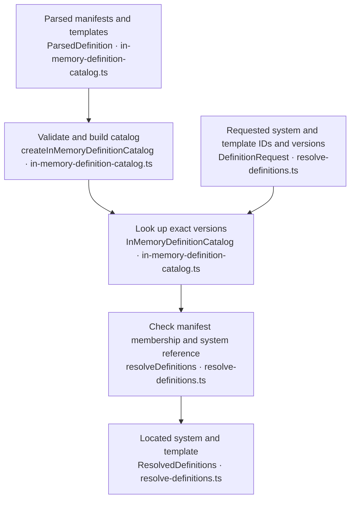
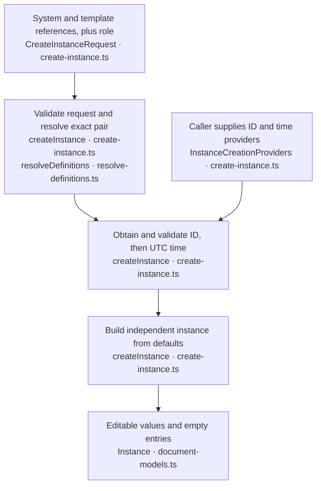
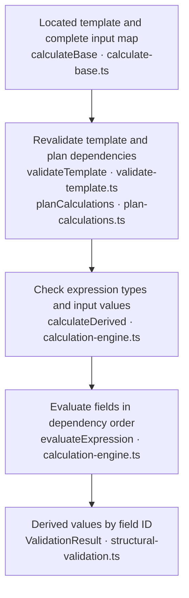
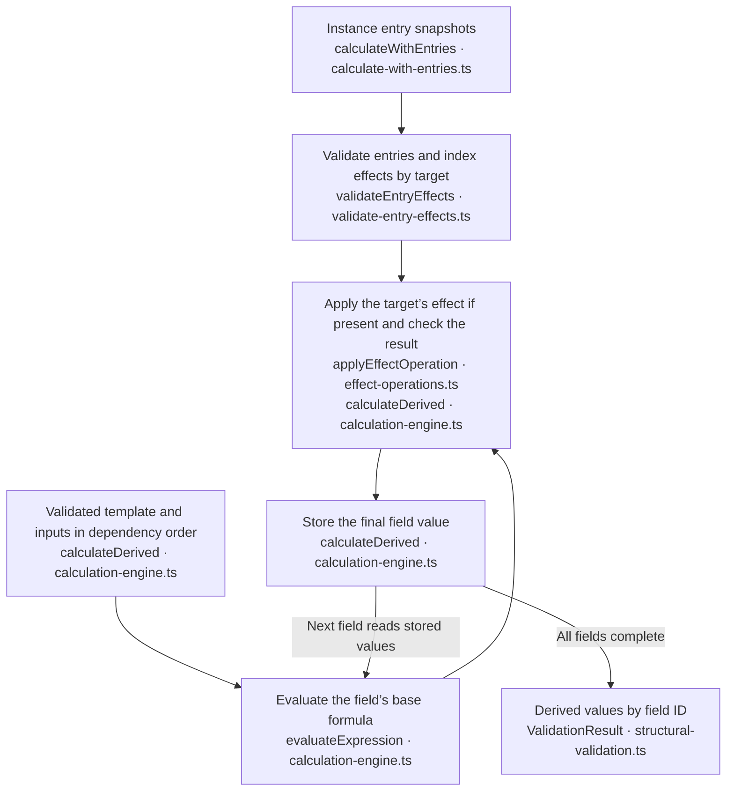

# Domain architecture

This is a living guide to the domain code. Update it when responsibilities, public APIs, data ownership or calculation flow change. The [constitution](../../specs/mission.md) and [v1 contract](../../data_contracts/contracts.md) define the governing requirements. This guide describes their implementation. For call signatures and diagnostic details, see the [domain API reference](README.md).

## Use cases

- [Resolve a system and template](#resolve-a-system-and-template) before creating or calculating an instance.
- [Create an instance](#create-an-instance) with independent source values.
- [Edit an instance](#edit-an-instance) and recompute its derived values.
- [Calculate base values](#calculate-base-values) from a resolved template and editable inputs.
- [Calculate with entry effects](#calculate-with-entry-effects) to include selected instance features.

Diagram boxes show the relevant function or type and its source filename. Public operations return a discriminated result. Check `success` before reading `value` or `diagnostics`. Failures return diagnostics without partial values. A diagnostic identifies a logical document and a JSON Pointer, with related locations where useful.

## Resolve a system and template

Use this when a caller has parsed manifests and templates and needs the exact pair referenced by an instance or creation request.



[Catalog construction](definition-processing/in-memory-definition-catalog.ts) validates every supplied [manifest](definition-processing/validate-manifest.ts) and [template](definition-processing/validate-template.ts) before exposing an index. Conflicting copies of the same version fail construction. The catalog owns snapshots and returns independent copies on lookup.

[Resolution](definition-processing/resolve-definitions.ts) checks that the exact system and template versions are available, that the manifest lists the template, and that the template points back to that system version. Missing versions fail at the requested reference. A caller can pass the resolved template directly to either calculation operation.

## Create an instance

Use this when a caller wants a new character or monster initialized from template defaults.



[Instance creation](instances/create-instance.ts) calls the providers after resolution succeeds. The caller supplies a fresh ID. The domain uses one timestamp for both creation and modification. Each instance owns its reference objects, input map and entries array. Calculation is a separate operation using the instance's inputs and, when applicable, its entries.

## Edit an instance

Pass a previously valid in-memory instance and one operation to [editInstance](instances/edit-instance.ts). Scalar operations use primitive arguments. Adding or replacing an entry uses JSON text for the complete snapshot, and removal uses its local ID. See the [operation signatures](README.md#instance-editing).

The operation applies the edit to a private candidate. It resolves the instance's exact definitions and validates and recomputes the candidate through [calculateWithEntries](calculation/calculate-with-entries.ts). The instance in the success result is the source state used for that calculation.

Setting the authored Ork's Toughness from 45 to 50 raises its effect-adjusted Toughness Bonus from 8 to 10. Removing Unnatural Toughness in a separate call recalculates the bonus to 5. Each call succeeds or fails independently, so the caller can continue from the last successful instance and results.

A changed instance receives a modification timestamp from the caller's UTC clock after calculation succeeds. An equivalent edit keeps the timestamp. Calculation diagnostics for source values and entries use separate logical documents, such as `ork values` and `ork entries`.

## Calculate base values

Use [calculateBase](calculation/calculate-base.ts) when you need derived values from a template's formulas alone. Supply a located template and a separate located input map.



The [shared engine](calculation/calculation-engine.ts) revalidates mutable template copies. The [dependency planner](calculation/plan-calculations.ts) checks missing references and cycles before the engine evaluates formulas. The base operation uses an empty entry array.

Inputs must contain exactly the declared own keys, with safe integer values inside their inclusive bounds. Template defaults describe initialization. Callers must supply a complete input map to calculate.

Supported operations are `constant`, `field`, `floor`, `divide`, `multiply`, `equal` and `if`. They form a data-defined expression tree. Every reference must name an input or derived field in the same template.

Both conditional branches contribute dependencies and undergo syntax and type checks. Evaluation executes only the selected branch. Derived fields must produce numbers, with boolean expressions permitted as conditional tests.

Numbers follow the v1 finite binary64 and safe-integer rules. Division by either signed zero fails. Every evaluated numeric intermediate is checked, negative zero becomes zero, and `floor` provides the explicit rounding operation.

### Example

This example assumes `catalog` was successfully created from parsed definitions and `instance` contains the caller's instance data.

```ts
const resolved = resolveDefinitions(
  catalog,
  { system: instance.system, template: instance.template },
  'instance',
);

if (resolved.success) {
  const calculated = calculateBase(resolved.value.template, {
    document: 'instance-values',
    value: instance.values,
  });

  if (calculated.success) {
    // With Strength 45, the creature template produces strengthBonus 4.
    const strengthBonus = calculated.value.strengthBonus;
  } else {
    // Present calculated.diagnostics to the caller.
  }
} else {
  // Present resolved.diagnostics to the caller.
}
```

These calls do not validate a complete saved instance. The example uses only its exact references and input values. Full saved-instance validation belongs to the loading phase.

## Calculate with entry effects

Use [calculateWithEntries](calculation/calculate-with-entries.ts) when the caller also has the instance's selected entry snapshots. The shared engine runs the base preparation flow and adds entry validation and effect application.



[Entry validation](calculation/validate-entry-effects.ts) runs after dependency planning and before expression type and input checks. It validates the closed v1 entry shape and effect targets before arithmetic. Entry diagnostic pointers are relative to the supplied array's logical document root, such as `/0/effects/0/target`.

Entry IDs must be unique. Descriptive fields and optional metadata are validated but never interpreted as rules. Multipliers must be positive safe integers targeting a declared derived modifier target. A second effect on a target fails with `MODIFIER_CONFLICT` and a related location for the first effect, even inside the same entry or with identical factors.

For the authored Ork, the base formula floors Toughness 45 divided by 10 to produce Toughness Bonus 4. The entry-aware calculation applies the selected Unnatural Toughness multiplier to produce 8. The engine stores 8 before evaluating any dependent field, so a field reference sees the modified bonus. The base-only call uses an empty entry array and returns 4.

Effects add no dependency edges. Each invocation owns fresh maps and preserves the caller's data and earlier results. The application layer retains the last valid instance on failure.

`EntryEffect` in `document-models.ts` defines the supported effect union. [The effect registry](calculation/effect-operations.ts) is checked with `satisfies EffectOperationHandlers`, keyed by every operation in that union. Each registration owns both closed-shape validation and arithmetic. Adding an operation to the union requires its registration at compile time; supported-operation diagnostics are derived from the registry keys. Unknown operations, including inherited object-property names, are rejected. New operations still require an explicit versioned contract/schema change and acceptance coverage.

## Shared data and utilities

| Piece              | Responsibility                                                                                                                 |
| ------------------ | ------------------------------------------------------------------------------------------------------------------------------ |
| System manifest    | Identifies a system version and lists its available exact template versions.                                                   |
| Template           | Defines generic sheet structure, inputs, bounds, defaults, derived formulas, sections and eligible modifier targets.           |
| Instance           | Holds one entity's identity, role, editable values, selected entry snapshots, timestamps and exact system/template references. |
| Calculation result | Holds recomputed derived values for the supplied inputs. The caller can use these for presentation.                            |

Calculation definitions live in templates. Instances remain small and readable, including for advanced users writing JSON manually. A saved instance carries its current source state and exact definition references. Resolving those references supplies the rules needed to calculate its derived values.

Published definition versions are immutable. A newer template does not implicitly change an existing instance's rules. Loading an instance requires its referenced definitions to be available.

Selected entries own snapshots of their descriptions and explicit effects. Those selections can survive changes to a future feature library. Their effects are part of the instance state, while generic formulas and permitted effect targets belong to the template.

[Document types](definitions/document-models.ts) define the manifest, template, instance and entry shapes. The `definitions/` folder holds [references and metadata](definitions/common.ts), [expression types](definitions/expressions.ts), [diagnostics](definitions/diagnostics.ts), and [identifier and version patterns](definitions/definition-patterns.ts). [Shared structural validation](instances/structural-validation.ts) owns result types, structural checks and pointer escaping. The [expression syntax checker](definition-processing/validate-expression.ts) runs during template validation.

## Boundaries and upcoming work

Domain modules depend on other domain modules. Filesystem access, Electron, React and concrete logging infrastructure belong outside this directory. The application layer will obtain definitions and source values, invoke domain operations, and present results or diagnostics.

| Capability                                                              | Current status                                                                       |
| ----------------------------------------------------------------------- | ------------------------------------------------------------------------------------ |
| Definition structure validation, in-memory catalog and exact resolution | Implemented.                                                                         |
| Dependency analysis and base expression evaluation                      | Implemented.                                                                         |
| Instance-entry effect application                                       | Implemented; Phase 10 acceptance and verifier migration are complete.                |
| In-memory instance creation                                             | Implemented.                                                                         |
| In-memory instance editing                                              | Implemented for source values, display name, career and entry snapshots.             |
| Complete saved-instance validation                                      | Planned in a later roadmap phase.                                                    |
| Library discovery, selected-system loading and persistence              | Planned in later roadmap phases.                                                     |
| Reusable feature library and selection provenance                       | Requires its own future specification. Current entries are instance-owned snapshots. |

The Python contract verifier retains schema and fixture integrity checks, including expression types/dependencies and snapshot compatibility. Phase 10 retired its arithmetic tracer and calculation API after migrating acceptance to the TypeScript tests; only TypeScript evaluates derived values.

## Verification and maintenance

Domain tests live under [tests/unit/domain](../../tests/unit/domain/). The dependency boundary test checks domain imports. Shared engine tests call calculateDerived directly and use independent expected results for the character and monster examples, edited scores, numeric boundaries and failure paths. Entry validation and operation registry tests call their owning modules directly. The public calculation API suites retain focused integration checks for base-only behavior, effect propagation, diagnostics, recovery and caller preservation.

Run `npm run test:unit` and `npm run typecheck` for domain changes. Run `npm run format:check` for documentation formatting. Follow the active phase's validation document for additional required checks.

When changing a public domain operation, update the relevant use case, flow and example here as needed. Keep implementation status explicit and preserve the distinction between stored source state and recomputed results. Detailed decisions and validation evidence remain in the phase specifications.
