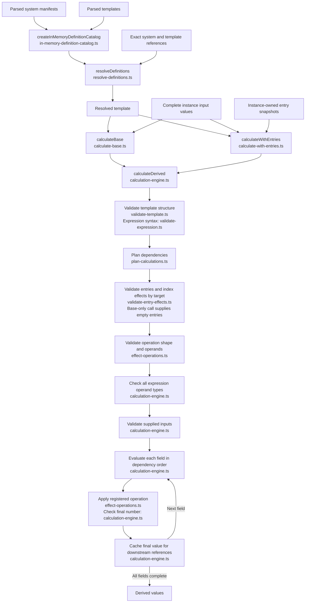

# Domain architecture

This is a living guide to the domain code. Update it when responsibilities, public APIs, data ownership or calculation flow change. The [constitution](../../specs/mission.md) and [v1 contract](../../data_contracts/contracts.md) define the governing requirements. This guide describes their implementation.

## What owns what

| Piece              | Responsibility                                                                                                                 |
| ------------------ | ------------------------------------------------------------------------------------------------------------------------------ |
| System manifest    | Identifies a system version and lists its available exact template versions.                                                   |
| Template           | Defines generic sheet structure, inputs, bounds, defaults, derived formulas, sections and eligible modifier targets.           |
| Instance           | Holds one entity's identity, role, editable values, selected entry snapshots, timestamps and exact system/template references. |
| Calculation result | Holds recomputed derived values for the supplied inputs. The caller can use these for presentation.                            |

Calculation definitions live in templates. Instances remain small and readable, including for advanced users writing JSON manually. A saved instance carries its current source state and exact definition references. Resolving those references supplies the rules needed to calculate its derived values.

Published definition versions are immutable. A newer template does not implicitly change an existing instance's rules. Loading an instance requires its referenced definitions to be available.

Selected entries own snapshots of their descriptions and explicit effects. Those selections can survive changes to a future feature library. Their effects are part of the instance state, while generic formulas and permitted effect targets belong to the template.

## Current flow

The domain receives parsed objects from its caller. The implemented flow is shown below.



Each public operation returns a discriminated result. Check `success` before reading `value` or `diagnostics`. A failure exposes diagnostics without partial results. Diagnostics identify a logical document and an RFC 6901 JSON Pointer, with related locations where useful.

The catalog validates the whole supplied bundle before exposing a usable index. It snapshots definitions and returns fresh copies from lookups. The resolver checks exact version availability, manifest membership and agreement between the requested system and the template's system reference.

Calculation receives the resolved template and a separate value map. It revalidates the mutable template copy, checks the dependency graph, checks types throughout every expression branch, and validates all inputs before evaluation. The result contains only derived values. Each call uses a fresh cache and preserves the caller's data.

Every processing block names its owning file. Structural validators share checks and JSON Pointer helpers from `validation.ts`. The entry-effects validator checks snapshot structure as well as effect compatibility and returns the validated effects indexed by target.

## Example

This example assumes `catalog` was successfully created from parsed definitions and `instance` contains the caller's instance data.

```ts
const resolved = resolveDefinitions(
  catalog,
  { system: instance.system, template: instance.template },
  'instance',
);

if (resolved.success) {
  const calculated = calculateBase(resolved.value.template, {
    document: 'instance-values',
    value: instance.values,
  });

  if (calculated.success) {
    // With Strength 45, the creature template produces strengthBonus 4.
    const strengthBonus = calculated.value.strengthBonus;
  } else {
    // Present calculated.diagnostics to the caller.
  }
} else {
  // Present resolved.diagnostics to the caller.
}
```

These calls do not validate a complete saved instance. The example uses only its exact references and input values. Full saved-instance validation belongs to the loading phase.

## Modules

| Module                                                             | Role                                                                                                                         |
| ------------------------------------------------------------------ | ---------------------------------------------------------------------------------------------------------------------------- |
| [common.ts](common.ts)                                             | Exact definition references and documentary metadata types.                                                                  |
| [documents.ts](documents.ts)                                       | Manifest, template, instance, field and entry shapes. Type declarations describe data but do not perform runtime validation. |
| [expressions.ts](expressions.ts)                                   | The restricted v1 expression union.                                                                                          |
| [diagnostics.ts](diagnostics.ts)                                   | Diagnostic codes and location shapes.                                                                                        |
| [definition-patterns.ts](definition-patterns.ts)                   | Shared identifier and version patterns.                                                                                      |
| [validation.ts](validation.ts)                                     | Result type, pointer escaping and shared structural checks.                                                                  |
| [validate-manifest.ts](validate-manifest.ts)                       | Manifest structure and document-local invariants.                                                                            |
| [validate-template.ts](validate-template.ts)                       | Template structure and document-local invariants.                                                                            |
| [validate-expression.ts](validate-expression.ts)                   | Closed expression syntax, including every conditional branch.                                                                |
| [in-memory-definition-catalog.ts](in-memory-definition-catalog.ts) | Validated definition indexing, snapshots, exact lookups and conflict checks.                                                 |
| [resolve-definitions.ts](resolve-definitions.ts)                   | Compatibility checks across the requested system and template.                                                               |
| [plan-calculations.ts](plan-calculations.ts)                       | Reference discovery, cycle detection and dependency order for a structurally validated template.                             |
| [calculate-base.ts](calculate-base.ts)                             | Full base-calculation validation and evaluation over a template and supplied inputs.                                         |
| [calculate-with-entries.ts](calculate-with-entries.ts)             | Effect-aware calculation over a template, inputs and instance-owned entry snapshots.                                         |
| [calculation-engine.ts](calculation-engine.ts)                     | Shared validation/evaluation flow for both calculation APIs.                                                                 |
| [validate-entry-effects.ts](validate-entry-effects.ts)             | Internal entry boundary, declared target checks and located multiplier conflict detection.                                   |
| [effect-operations.ts](effect-operations.ts)                       | Exhaustive registry of effect shape validation and arithmetic handlers.                                                      |

## Calculation rules

`EntryEffect` in `documents.ts` defines the supported effect union. `effect-operations.ts` has a handler registry checked with `satisfies EffectOperationHandlers`, keyed by every operation in that union. Each registration owns both closed-shape validation and arithmetic. Adding an operation to the union requires its registration at compile time; supported-operation diagnostics are derived from the registry keys. Unknown operations, including inherited object-property names, are rejected. New operations still require an explicit versioned contract/schema change and acceptance coverage.

Supported operations are `constant`, `field`, `floor`, `divide`, `multiply`, `equal` and `if`. They form a data-defined expression tree. Every reference must name an input or derived field in the same template.

Both conditional branches contribute dependencies and undergo syntax and type checks. Evaluation executes only the selected branch. Derived fields must produce numbers, with boolean expressions permitted as conditional tests.

Numbers follow the v1 finite binary64 and safe-integer rules. Division by either signed zero fails. Every evaluated numeric intermediate is checked, negative zero becomes zero, and `floor` provides the explicit rounding operation.

Inputs must contain exactly the declared own keys, with safe integer values inside their inclusive bounds. Template defaults describe initialization. Callers must supply a complete input map to calculate.

`calculateWithEntries(template, sourceValues, entries)` accepts three located documents. Like `calculateBase`, it revalidates mutable template copies, graph dependencies, expression types and the complete input map. It also validates the unknown entry array against the closed v1 shape before arithmetic. Entry diagnostic pointers are relative to this array's logical document root (for example `/0/effects/0/target`); callers choose its document label. It does not validate full instance identity, timestamps or persistence state.

Entry IDs must be unique. Descriptive fields and optional metadata are validated but never interpreted as rules. Multipliers must be positive safe integers targeting a declared derived modifier target. A second effect on a target fails with `MODIFIER_CONFLICT` and a related location for the first effect, even inside the same entry or with identical factors.

The shared engine computes a field's base expression, applies its one multiplier, checks the final number, then caches that final value for downstream references. Effects add no dependency edges. Each invocation owns fresh maps and returns only derived values; failures expose diagnostics without a partial value. Caller data and previously returned results are preserved. The application layer remains responsible for retaining the last valid instance. `calculateBase` calls the same engine without effects and retains its public signature and base-only behavior.

## Boundaries and upcoming work

Domain modules depend on other domain modules. Filesystem access, Electron, React and concrete logging infrastructure belong outside this directory. The application layer will obtain definitions and source values, invoke domain operations, and present results or diagnostics.

| Capability                                                              | Current status                                                                       |
| ----------------------------------------------------------------------- | ------------------------------------------------------------------------------------ |
| Definition structure validation, in-memory catalog and exact resolution | Implemented.                                                                         |
| Dependency analysis and base expression evaluation                      | Implemented.                                                                         |
| Instance-entry effect application                                       | Implemented; Phase 10 acceptance and verifier migration are complete.                |
| Instance creation, editing and complete saved-instance validation       | Planned in later roadmap phases.                                                     |
| Library discovery, selected-system loading and persistence              | Planned in later roadmap phases.                                                     |
| Reusable feature library and selection provenance                       | Requires its own future specification. Current entries are instance-owned snapshots. |

For the authored Ork, base Toughness Bonus is 4 at Toughness 45. `calculateWithEntries` applies its selected Unnatural Toughness multiplier to produce 8; `calculateBase` continues to return 4.

The Python contract verifier retains schema and fixture integrity checks, including expression types/dependencies and snapshot compatibility. Phase 10 retired its arithmetic tracer and calculation API after migrating acceptance to the TypeScript tests; only TypeScript evaluates derived values.

## Verification and maintenance

Source tests mirror the domain modules under [tests/unit/domain](../../tests/unit/domain/). The dependency boundary test checks domain imports. Shared engine tests call calculateDerived directly and use independent expected results for the character and monster examples, edited scores, numeric boundaries and failure paths. Entry validation and operation registry tests call their owning modules directly. The public calculation API suites retain focused integration checks for base-only behavior, effect propagation, diagnostics, recovery and caller preservation.

Run `npm run test:unit` and `npm run typecheck` for domain changes. Run `npm run format:check` for documentation formatting. Follow the active phase's validation document for additional required checks.

When changing a public domain operation, update its module entry, flow and example here as needed. Keep implementation status explicit and preserve the distinction between stored source state and recomputed results. Detailed decisions and validation evidence remain in the phase specifications.
